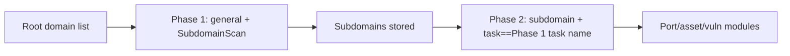

---

## name: scopesentry-mcp
description: Manage the ScopeSentry security scanning platform (projects, tasks, templates, assets, nodes) through the ScopeSentry MCP. Use when the user mentions ScopeSentry, MCP, API Keys, scan tasks, or asset queries.

# ScopeSentry MCP Usage Guide

For users of a **deployed ScopeSentry instance**. Connect to the platform through Cursor (or another MCP client); no local source code is needed.

## 1. Preparation

### 1.1 Confirm the Service Is Reachable

- Default web UI: `http://<host>`
- MCP endpoint: `http://<host>/mcp` (if a reverse proxy or frontend proxy sits in front, use the actual `/mcp` address)

### 1.2 Create an API Key

1. Log in to the ScopeSentry web UI in a browser
2. Create a key on the **API Key** management page (or through an API provided by your administrator)
3. Save the returned `ssk_...` string (**shown only once**)

### 1.3 Configure the Cursor MCP Server

Cursor → Settings → MCP → add server:

```json
{
  "mcpServers": {
    "scopesentry": {
      "url": "http://<your-host>:8082/mcp",
      "headers": {
        "X-API-Key": "ssk_your-key"
      }
    }
  }
}
```

Alternatively, use: `Authorization: Bearer ssk_your-key`

After configuring, restart the MCP server or reload Cursor, and confirm that tools such as `list_projects` and `list_assets` appear in the tool list.

---

## 2. Tool Overview


| Tool                   | Purpose             |
| ---------------------- | ------------------- |
| `list_projects`        | Project tree grouped by tag (includes project IDs) |
| `list_projects_data`   | Paginated project list, searchable by name |
| `get_project`          | Project details     |
| `create_project`       | Create project      |
| `list_tasks`           | Scan task list      |
| `get_task`             | Task details        |
| `list_scan_templates`  | Scan template list  |
| `get_scan_template`    | Template details    |
| `list_plugin_modules`  | Scan pipeline module names |
| `list_plugins`         | Available plugins (including hash and default parameters) |
| `create_scan_template` | Create scan template |
| `create_scan_task`     | Create scan task    |
| `list_assets`          | Query assets of various types (paginated list) |
| `count_assets`         | Count assets (`/api/assets/common/total`) |
| `get_asset_detail`     | Asset or vulnerability details |
| `add_asset_tag`        | Add a tag to an asset |
| `list_nodes`           | Scan node list      |


Refer to the MCP tool descriptions (schema) for the parameters of each tool. `list_assets` and `count_assets` use the same `search` and `filter` syntax, so read the `list_assets` description before querying assets.

When you need to know the total count, use `count_assets` (which corresponds to the web pagination total endpoint) instead of repeatedly paging through `list_assets` just to count.

---

## 3. Common Workflows

### 3.1 Query Assets by Project

When the user or context **already has a project condition**, prefer including `filter.project` to narrow the scope and avoid slow responses from too much cross-project data. If there is no explicit project, you do not need to force a project filter.

1. Call `list_projects` or `list_projects_data` to get the target project's **ObjectID** (`id` / `children[].value`)
2. Pass `filter.project` to `list_assets` (**must be the ID, not the project's display name**)

```json
{
  "asset_type": "asset",
  "pageIndex": 1,
  "pageSize": 20,
  "search": "domain=^example.com",
  "filter": {
    "project": ["<project-ObjectID>"]
  }
}
```

### 3.2 Create a Scan Task

1. `list_nodes` to get the names of online nodes
2. `list_scan_templates` or `create_scan_template` to get the template **ObjectID**
3. `create_scan_task`: `name` and `node` are required; `template` takes the template ID (not the template name)

**Target source `targetSource` (consistent with the web UI):**

| targetSource | Description | Required parameters |
| --- | --- | --- |
| `general` | Enter targets directly | `target` |
| `project` | Read targets from a project | `project` (array of project ObjectIDs) |
| `asset` | Search the web asset library | `search`; optional `project`, `filter`, `targetNumber` |
| `RootDomain` | Search the root domain library | `search`; optional `project`, `filter`, `targetNumber` |
| `subdomain` | Search the subdomain library | `search`; optional `project`, `filter`, `targetNumber` |
| `UrlScan` | Search URL scan results | `search`; optional `project`, `filter`, `targetNumber` |
| `*Source` (e.g. `subdomainSource`) | Created from the asset page's "select/search" action | `targetTp=search`: use `search`; `targetTp=select`: use `targetIds` |

**Example — scan a root domain directly:**

```json
{
  "name": "example-subdomain-collection",
  "node": ["node-1"],
  "template": "<template-ObjectID>",
  "targetSource": "general",
  "target": "example.com\nfoo.com",
  "project": ["<project-ObjectID>"]
}
```

**Example — continue scanning from the subdomain library (filtered by a previous task name):**

```json
{
  "name": "example-ports-and-vulns",
  "node": ["node-1"],
  "template": "<later-module-template-ObjectID>",
  "targetSource": "subdomain",
  "search": "task==\"example-subdomain-collection\"",
  "project": ["<project-ObjectID>"]
}
```

### 3.3 Full Root Domain Information Gathering (Recommended Two-Phase Approach)

When the input is a **root domain** and you want **full information gathering**, it is recommended to split the work into two scans rather than running the full pipeline at once.

**Reason:** Distributed tasks are dispatched with a **single target** as the unit. When a root domain is the target, once a node receives that root domain, the subdomains it discovers on that node will also continue to run the later modules on that same node. This can cause uneven load, slowness, and errors.

**Best practices:**

1. **Phase 1 — subdomain collection only**
   - `targetSource`: `general`
   - `target`: all root domains (multi-line)
   - Template: enable only `SubdomainScan` and `SubdomainSecurity` (subdomain scanning + subdomain takeover)
   - Use `get_task` to wait for the task to finish

2. **Phase 2 — subsequent modules**
   - `targetSource`: `subdomain`
   - `search`: `task=="<phase-1-task-name>"` (exact match on the task name)
   - Optionally `project` to narrow the scope
   - Template: port scanning, asset mapping, vulnerability scanning, etc. (may omit SubdomainScan)
   - Subdomains are dispatched to each node as independent targets, which gives higher parallel efficiency

You can also filter by task name on the web UI "Subdomains" asset page and then use "Create task from subdomains". The effect is the same.



### 3.4 Create a Scan Template

1. `list_plugin_modules` → list of module names
2. `list_plugins` (optionally filtered by `module`) → each plugin's `hash` and default `parameter`
3. `create_scan_template`: use `modules` to specify the "module → array of plugin hashes" mapping

---

## 4. Asset Queries (`list_assets` / `count_assets`)

`count_assets` uses the same `asset_type`, `search`, and `filter` as `list_assets`, and returns `{ "total": N }`, corresponding to the web endpoint `/api/assets/common/total`.

```json
{
  "asset_type": "subdomain",
  "search": "task==\"some-task-name\"",
  "filter": {"project": ["<project-ObjectID>"]}
}
```

**Performance tips (common to `list_assets` / `count_assets`):** When a project condition exists, prefer `filter.project` to narrow the scope. In `search`, use `==` exact match or `^` prefix match for indexed fields where possible (see [4.3](#43-search-expression)), and avoid large-scale `=` fuzzy queries that slow down responses. Without a project context, you do not need to force a project filter.

For the types that support `filter.project`, see the table in [4.4](#44-filter-exact-filtering).

### 4.1 Asset Type `asset_type`

`asset`, `RootDomain`, `subdomain`, `app`, `mp`, `UrlScan`, `SensitiveResult`, `DirScanResult`, `crawler`, `vulnerability`, `PageMonitoring`, `IPAsset`, `SubdomainTakerResult`

Alias examples: `web`→asset, `vuln`→vulnerability, `ip`→IPAsset, `url`→UrlScan

### 4.2 Parameters


| Parameter                | Description                             |
| ------------------------ | --------------------------------------- |
| `pageIndex` / `pageSize` | Pagination, default 1 / 20              |
| `search`                 | Search expression (see next section)    |
| `filter`                 | Exact filter JSON (see next section)    |
| `sort`                   | Only UrlScan and DirScanResult support sorting by `length` |
| `sid`                    | Only SensitiveResult: sensitive rule name |


`search` and `filter` **can be used together**.

### 4.3 search Expression

Custom DSL (**not SQL**):


| Operator | Meaning | Index | Example                     |
| ---- | ---- | ---- | --------------------------- |
| `=`  | Fuzzy match (regex) | No index | `domain=example`            |
| `==` | Exact match (full equality) | **Uses index** | `port==443`                 |
| `!=` | Exclude | — | `port!="80"`                |
| `&&` | AND | — | `domain==example.com && port==443` |
| `||` | OR | — | `title=admin || body=login` |


**Indexes and operators:** Fields such as `domain`, `ip`, `port`, and `title` are indexed, but only **`==` exact match** or a **prefix match where the value starts with `^`** (e.g. `domain=^example.com`) can use the index. **`=` is converted to a regex fuzzy match and cannot use the index**, so it can become slow with large data volumes.

**Common search fields for all types:** `tag`, `task` (task name), `rootDomain`

**project cannot be written in search** (it is invalid or causes an error when combined with `&&`). To filter by project, use `filter.project`.

**Common search fields by type:**


| asset_type           | Fields                                                                              |
| -------------------- | ----------------------------------------------------------------------------------- |
| asset                | domain, ip, port, service, app, title, statuscode, icon, banner, type, body, header |
| RootDomain           | domain, icp, company                                                                |
| subdomain            | domain, ip, type, value                                                             |
| app                  | name, icp, company, category, description, url, apk                                 |
| mp                   | name, icp, company, category, description, url                                      |
| UrlScan              | url, input, source, resultId, type                                                  |
| SensitiveResult      | url, sname, body, info, md5                                                         |
| DirScanResult        | url, statuscode, redirect, length                                                   |
| vulnerability        | url, vulname, matched, request, response, level                                     |
| crawler              | url, method, body, resultId                                                         |
| PageMonitoring       | url, hash, diff, response                                                           |
| IPAsset              | ip, domain, port, service, webServer, app                                           |
| SubdomainTakerResult | domain, value, type, response                                                       |


**search examples:**

- `domain==www.example.com && port==443` (exact match, uses the index)
- `domain=^example.com` (prefix match, uses the index)
- `ip==192.168.1.1`
- `task=="some-task-name"`
- `level==high` (vulnerability)
- `statuscode==200` (DirScanResult)

Use `=` only when you need fuzzy contains matching, e.g. `title=admin` (does not use the index, so narrow the scope with conditions such as project).

### 4.4 filter Exact Filtering

A JSON object: multiple values under the same key are **OR**, and different keys are **AND**.

**When a project condition exists, prefer `project`:** If the user or context has clearly specified a project and the asset_type supports `project`, include it to narrow the scope. Do not force it when no project information is available.


| filter key   | Meaning  | Value description                                        |
| ------------ | -------- | -------------------------------------------------------- |
| `project`    | Owning project | **ObjectID**, get from `list_projects` / `list_projects_data` |
| `task`       | Source task | **Task name**, use `name` from `list_tasks`              |
| `port`       | Port     | e.g. `"443"`                                             |
| `service`    | Service/protocol | e.g. `"https"`                                       |
| `app`        | Application fingerprint | e.g. `"Nginx"`                            |
| `icon`       | Icon hash |                                                         |
| `statuscode` | HTTP status code | Mainly used for asset                           |
| `status`     | Status   | UrlScan/DirScan HTTP code; vulnerability/sensitive info handling status |
| `level`      | Vulnerability level | critical / high / medium / low / info         |
| `type`       | Type     | e.g. subdomain record types A, CNAME                    |
| `color`      | Sensitive rule color | SensitiveResult                             |
| `sname`      | Sensitive rule name | SensitiveResult                              |
| `tags`       | Tags     |                                                          |


**Available filter keys by type:**


| asset_type                            | filter key                                                      |
| ------------------------------------- | --------------------------------------------------------------- |
| asset                                 | project, port, service, app, icon, statuscode, type, task, tags |
| RootDomain                            | project, tags                                                   |
| subdomain                             | project, type, task, tags                                       |
| app / mp                              | project, tags                                                   |
| UrlScan                               | status, tags                                                    |
| DirScanResult                         | status, tags                                                    |
| SensitiveResult                       | status, color, sname, tags                                      |
| crawler                               | project, task, tags                                             |
| vulnerability                         | project, level, status, task, tags                              |
| PageMonitoring / SubdomainTakerResult | tags                                                            |
| IPAsset                               | project, port, service, app                                     |


**filter examples:**

```json
{"project": ["<project-ObjectID>"], "port": ["443"]}
```

**Combined query example:**

```json
{
  "asset_type": "asset",
  "search": "domain=^baidu && port==443",
  "filter": {"project": ["<project-ObjectID>"]},
  "pageIndex": 1,
  "pageSize": 10
}
```

**Notes:**

- When a project condition exists, prefer `filter.project` (where supported); without project context, it is not required
- Do not put the project display name in `filter.project`
- Use `==` for known values and `^` for prefixes; avoid overusing `=` fuzzy matching on large tables
- For the HTTP status of UrlScan, use `filter.status`; for DirScanResult, you can use `statuscode==200` in search
- For SensitiveResult, filter by rule name: use `sname=<rule-name>` in `search`, or `filter.sname`

### 4.5 Sorting `sort`

Only **UrlScan** and **DirScanResult** support:

```json
{"length": "ascending"}
```

Other types ignore `sort` and use the default time-based ordering.

---

## 5. Scan Template Module Names

`TargetHandler`, `SubdomainScan`, `SubdomainSecurity`, `PortScanPreparation`, `PortScan`, `PortFingerprint`, `AssetMapping`, `AssetHandle`, `URLScan`, `WebCrawler`, `URLSecurity`, `DirScan`, `VulnerabilityScan`, `PassiveScan`

---

## 6. Troubleshooting


| Symptom   | Action                                             |
| --------- | -------------------------------------------------- |
| MCP has no tools | Check the URL, the API Key, and whether ScopeSentry is running |
| 401 / 403 | Recreate or replace the API Key                    |
| Assets not found | Confirm `filter.project` is an ObjectID; do not write project in search |
| Template/task creation fails | `template` must be the template ObjectID; `node` must be the online node name |
| Query is slow or stuck | When a project is set, add `filter.project`; use `==` or the `^` prefix on indexed fields in search, and use `=` sparingly; reduce `pageSize` |


---

